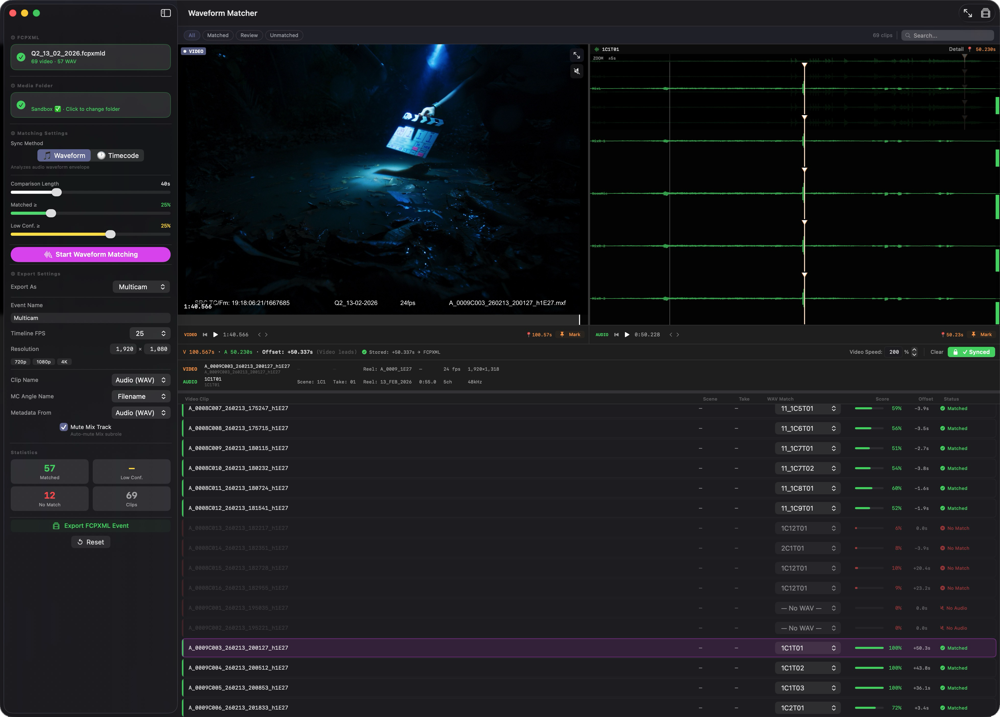

# คู่มือการใช้งาน WaveformMatcher

---

## สารบัญ
1. [WaveformMatcher คืออะไร](#1-waveformmatcher-คืออะไร)
2. [ทำไมต้อง WaveformMatcher](#2-ทำไมต้องใช้-waveformmatcher)
3. [ความต้องการของระบบ](#3-ความต้องการของระบบ)
4. [การติดตั้ง](#4-การติดตั้ง)
5. [ภาพรวมหน้าจอ](#5-ภาพรวมหน้าจอ)
6. [Workflow มาตรฐาน](#6-workflow-มาตรฐาน)
7. [Metadata View](#7-metadata-view)
8. [Timeline Detail](#8-timeline-detail)
9. [ฟีเจอร์เสริม](#9-ฟีเจอร์เสริม)
10. [Keyboard Shortcuts](#10-keyboard-shortcuts)
11. [ลิงก์และทรัพยากร](#11-ลิงก์และทรัพยากร)

---

## 1. WaveformMatcher คืออะไร

**WaveformMatcher** คือแอปพลิเคชันสำหรับ macOS ที่ออกแบบมาเพื่อแก้ปัญหาการซิงค์เสียงระหว่างคลิปวิดีโอที่ถ่ายจากกล้องกับไฟล์เสียงคุณภาพสูง (WAV) ที่บันทึกแยกจากเครื่องบันทึกเสียงมืออาชีพ

### การทำงานพื้นฐาน
- วิเคราะห์คลื่นเสียง (Audio Waveform) จากวิดีโอและไฟล์ WAV
- หาจุดที่ตรงกันอัตโนมัติด้วยเทคโนโลยี Audio Fingerprinting
- ใช้ Timecode สำหรับการจับคู่เมื่อมีข้อมูล Timecode ที่ถูกต้อง
- ตรวจและแก้ metadata กองถ่ายในตารางแบบ spreadsheet
- นำเข้า metadata จาก CSV, XLSX และ PDF โดยประมวลผล PDF/OCR ในเครื่อง
- ปรับ sync offset รายคลิปใน Timeline Detail ที่แสดง waveform ตรงสเกลเดียวกัน
- ส่งออกไฟล์ FCPXML ที่พร้อมนำเข้า Final Cut Pro ทันที

---

## 2. ทำไมต้องใช้ WaveformMatcher

### ปัญหาในงานตัดต่อวิดีโอ

ในการถ่ายทำภาพยนตร์หรือวิดีโอมืออาชีพ:
- **กล้อง** จะบันทึกเสียงสำรอง (Scratch Audio) ที่มีคุณภาพต่ำเพื่อใช้อ้างอิง
- **ฝ่ายเสียง** จะบันทึกเสียงจริงด้วยอุปกรณ์คุณภาพสูง (เช่น Sound Devices, Zoom) ออกมาเป็นไฟล์ WAV

**ปัญหา:** เมื่อมีคลิปวิดีโอหลายสิบหรือหลายร้อยคลิป คุณต้อง:
1. จับคู่คลิปวิดีโอแต่ละคลิปกับไฟล์ WAV ที่ตรงกัน
2. ซิงค์ให้ตรงเวลาอย่างแม่นยำ
3. ทำซ้ำๆ ด้วยมือใน Final Cut Pro ซึ่งใช้เวลานานมาก

### วิธีแก้ของ WaveformMatcher

✅ **อัตโนมัติ 100%** - วิเคราะห์และจับคู่อัตโนมัติ  
✅ **แม่นยำ** - ใช้ Audio Fingerprinting และ Timecode  
✅ **ประหยัดเวลา** - จากหลายชั่วโมงเหลือไม่กี่นาที  
✅ **พร้อมใช้งาน** - ส่งออก FCPXML ที่ import เข้า Final Cut Pro ได้ทันที

---

## 3. ความต้องการของระบบ

### ระบบปฏิบัติการ
- **macOS 14.0+** (Sonoma หรือใหม่กว่า)

### ซอฟต์แวร์ที่จำเป็น
- **Final Cut Pro** (สำหรับ import ผลลัพธ์)

### ไฟล์ที่ต้องมี
- **FCPXML** จาก Final Cut Pro (ไฟล์ `.fcpxml` หรือ package `.fcpxmld`)
- **ไฟล์ WAV** จากฝ่าย Sound (เสียงคุณภาพสูงจากกองถ่าย)

---

## 4. การติดตั้ง

WaveformMatcher 1.4.6 เป็นต้นไปเซ็นด้วย Developer ID และผ่านการ Notarize จาก Apple แล้ว

1. เปิดไฟล์ DMG ที่ดาวน์โหลดมา
2. ลาก `WaveformMatcher.app` ไปยังโฟลเดอร์ **Applications**
3. เปิด WaveformMatcher จาก Applications ได้ตามปกติ

---

## 5. ภาพรวมหน้าจอ

เมื่อเปิดแอปครั้งแรก คุณจะเห็นหน้าจอหลักที่แบ่งเป็น 3 ส่วน:

### ส่วนประกอบหลัก

#### แผงซ้าย (Sidebar)
- **FCPXML**: แสดงไฟล์ที่โหลดอยู่
- **Media Folder**: โฟลเดอร์ที่เก็บไฟล์ WAV
- **Matching Settings**: ตั้งค่าโหมดการซิงค์
- **Metadata**: เปิด Metadata View และเลือก source สำหรับ preview/export
- **ตั้งค่า Output**: รูปแบบ การตั้งชื่อ format และตัวเลือกส่งออก กด export ได้จากปุ่มล่างสุดของแผงซ้าย, toolbar หรือ `Cmd+E`
- **หน้าเริ่มต้น**: ก่อนโหลดไฟล์ พื้นที่กลางหน้าต่างจะให้เลือก FCPXML จากโปรแกรมตัดต่อ หรือไฟล์ Video + Audio และปุ่ม **เปิดโปรเจกต์…** เพื่อทำ `.wmproj` ที่บันทึกไว้ต่อ เมื่อโหลดแล้ว toolbar จะแสดงแหล่งไฟล์ ถ้าต้องการใช้ media ชุดอื่นให้เริ่ม New Project

#### พื้นที่หลัก (Main Area)
- **Sync View**: Video/Audio viewer, inspector, Timeline Detail และตารางผล sync
- **Metadata View**: ตารางแก้ metadata และเครื่องมือ Import/Export
- **สลับ View**: `Cmd+1` เปิด Sync View และ `Cmd+2` เปิด Metadata View
- **Table Scale**: ปรับขนาดตารางร่วมกันทั้งสอง view (`+` / `-` หรือ `Cmd++` / `Cmd+-` / `Cmd+0` เมื่อชี้เมาส์ที่ตาราง)
- **ปุ่ม zoom**: `Cmd++`, `Cmd+-` และ `Cmd+0` (แสดงเต็ม) zoom สิ่งที่ชี้เมาส์อยู่: ภาพ video, waveform เสียง, Timeline Detail หรือตาราง ถ้าไม่ได้ชี้ที่ใด จะ zoom timeline ใน Sync View และตารางใน Metadata View
- **ความกว้างคอลัมน์**: ลากขอบหัวคอลัมน์ใน Sync View เพื่อปรับความกว้าง แอปจะจำค่าไว้
- **Status bar**: แถบด้านล่างหน้าต่างแสดงสถานะปัจจุบัน (จำนวนคลิป ผล match งานที่ทำอยู่เบื้องหลัง) และ keyboard hint ของ view ที่ใช้งานอยู่

---

## 6. Workflow มาตรฐาน

### ขั้นตอนที่ 1 — Export FCPXML จาก Final Cut Pro

ก่อนใช้ WaveformMatcher คุณต้อง export ข้อมูลออกจาก Final Cut Pro ก่อน

#### แบบ Event (แนะนำ)
1. เปิด Final Cut Pro
2. ไปที่ Library → คลิกขวาที่ **Event** ที่ต้องการ
3. เลือก **Export FCPXML**
4. บันทึกเป็นไฟล์ `.fcpxml` หรือ `.fcpxmld`

#### แบบ Timeline (Project)
1. เปิด Timeline/Project ที่ต้องการ
2. เมนู **File → Export XML**
3. เลือก format เป็น **FCPXML**
4. บันทึกไฟล์

### ขั้นตอนที่ 2 — Import FCPXML เข้า WaveformMatcher

มี 5 วิธี:

#### วิธี A — ลากไฟล์วาง (Drag & Drop)
- ลากไฟล์ `.fcpxml` หรือ `.fcpxmld` มาวางที่ปุ่ม **Import** ในแอป

#### วิธี B — เมนู File
- ไปที่ **File → Import FCPXML…** 
- หรือกด `Cmd+I`

#### วิธี C — Workflow Extension (ถ้าติดตั้ง)
1. ใน Final Cut Pro เปิด **Workflow Extension** ของ WaveformMatcher
2. ลาก **Event** หรือ **Timeline** จาก Final Cut Pro เข้า panel
3. แอปหลักจะเปิดขึ้นมาพร้อมข้อมูลอัตโนมัติ

#### วิธี D — เปิดไฟล์ .wmproj
- ดับเบิลคลิกที่ไฟล์ `.wmproj` ใน Finder (สำหรับงานที่เคยบันทึกไว้)

#### วิธี E — เปิดไฟล์ Media โดยตรง (ไม่ต้องมี FCPXML)
- ที่หน้าเริ่มต้น (กลางหน้าต่าง) กดปุ่ม **Video** และ **Audio** (หรือลากไฟล์/โฟลเดอร์มาวาง) แต่ละปุ่มรับเฉพาะไฟล์ประเภทของตัวเอง จึงเลือกโฟลเดอร์กล้องและโฟลเดอร์เสียงแยกกันได้ และการเลือกใหม่จะแทนที่เฉพาะฝั่งนั้น
- **File → เปิดไฟล์ Media…** (`Shift+Cmd+I`) เลือกรวมกันได้ แอปจะแยกประเภทตามนามสกุลไฟล์ให้
- แอปค้นหาไฟล์ในโฟลเดอร์ย่อยทั้งหมด รองรับ video แบบ MOV, MP4, M4V, MXF และ audio แบบ WAV, AIFF, MP3, M4A, CAF
- timecode ของ video อ่านจาก QuickTime timecode track ส่วน timecode ของ WAV อ่านจาก BWF `bext` (หรือ timestamp ใน iXML) โดยไม่ต้องใช้ FFprobe
- ข้อมูล iXML จะเติม Scene, Take, Reel (Tape), Note, Good Take (Circled) และชื่อ channel (เป็น role `dialogue.<ชื่อ track>`)
- ไฟล์ที่เครื่องนี้อ่านไม่ได้ (เช่น BRAW หรือ R3D) จะแจ้งรายการหลัง import ให้นำเข้าไฟล์เหล่านั้นผ่าน FCPXML จากโปรแกรมตัดต่อแทน

### ขั้นตอนที่ 3 — ตั้งค่า Media Folder

แอปต้องรู้ว่าไฟล์ WAV อยู่ที่ไหน:

1. ดูที่แผงซ้าย ส่วน **Media Folder**
2. กด **Click to change folder**
3. เลือกโฟลเดอร์ที่เก็บไฟล์ WAV ทั้งหมด
4. แอปจะสแกนหาไฟล์ WAV ในโฟลเดอร์นั้นและโฟลเดอร์ย่อยอัตโนมัติ

### ขั้นตอนที่ 4 — เลือกโหมดการ Sync

แอปมี 3 โหมดในส่วน **Matching Settings**:

#### 🟢 Waveform (แนะนำให้ลองก่อน)

**การทำงาน:** วิเคราะห์คลื่นเสียง (Audio Waveform) ของทั้งวิดีโอและ WAV แล้วหาจุดที่ตรงกันอัตโนมัติ

**เหมาะสำหรับ:**
- คลิปที่มีเสียงบันทึกชัดเจน
- กรณีที่ไม่มี Timecode
- การถ่ายทำทั่วไป

**การตั้งค่า:** ระบบใช้ค่าที่ทดสอบไว้เป็นค่าเริ่มต้น กด **ปรับค่า Matching** เมื่อต้องการจูนเฉพาะงาน
- **Comparison Length**: ความยาวของเสียงที่ใช้เปรียบเทียบ (ค่าเริ่มต้น 40s)
  - สั้นลง = เร็วขึ้น แต่อาจแม่นยำน้อยลง
  - ยาวขึ้น = ช้าลง แต่แม่นยำมากขึ้น
- **Matched ≥**: เกณฑ์คะแนน match ขั้นต่ำที่ถือว่า "matched" (ค่าเริ่มต้น 25%)
- **Low Conf. ≥**: เกณฑ์ที่ถือว่า "match ต่ำ/ไม่แน่ใจ" (ค่าเริ่มต้น 25%)

**วิธีใช้:** กดปุ่ม **Start Waveform Matching**

#### 🔵 Timecode

**การทำงาน:** ใช้ embedded timecode ที่บันทึกอยู่ในไฟล์วิดีโอและ WAV เพื่อจับคู่โดยตรง

**เหมาะสำหรับ:**
- กล้องและเครื่องอัดเสียงที่ sync timecode กันไว้ตั้งแต่กองถ่าย
- ใช้อุปกรณ์เช่น Tentacle Sync, Ambient Master Clock, Timecode Systems
- ให้ผลแม่นยำที่สุดถ้ามี timecode ที่ถูกต้อง

**ข้อควรระวัง:**
- ถ้า timecode ไม่ตรงกัน ผลจะผิดพลาด
- ตรวจสอบว่าทั้งกล้องและเครื่องเสียงใช้ timecode เดียวกัน

#### 🟡 Manual

**การทำงาน:** เปิดคลิปใน Sync View เพื่อเลือก Audio ตั้งจุด sync และ lock ผลลัพธ์ทีละคลิป

**เหมาะสำหรับ:**
- คลิปที่ waveform match ไม่สำเร็จ
- การตรวจสอบและแก้ไขผลที่แอปทำให้
- งานที่ต้องการความแม่นยำสูงสุด
- กรณีที่ต้องการเลือก Audio เองทีละคลิป

หลังจากรัน sync ทั้งโปรเจกต์แล้ว หากเริ่ม Waveform, Timecode หรือ Manual Sync อีกครั้ง แอปจะถามยืนยันเพราะผลลัพธ์และค่าที่แก้ไว้จะถูกแทนที่ หากต้องการแก้เพียงคลิปเดียว ให้ใช้ **Resync** ใน Timeline Detail หรือปรับด้วย Manual Sync

### ขั้นตอนที่ 5 — ตรวจสอบผลการ Match

หลัง matching เสร็จ คลิปจะถูกแบ่งเป็น 4 กลุ่มผ่านแท็บด้านบน:

| แท็บ | ความหมาย | การดำเนินการ |
|------|----------|--------------|
| **All** | แสดงคลิปทั้งหมด | ดูภาพรวม |
| **Matched** | คลิปที่ match สำเร็จ (สีเขียว ✓) | ตรวจ offset ว่าสมเหตุสมผล |
| **Review** | คลิปที่ match ได้แต่คะแนนต่ำ | ควรตรวจด้วย Manual Sync |
| **Unmatched** | คลิปที่ match ไม่สำเร็จ | ต้องทำ Manual Sync |

**ในตารางแต่ละแถว จะเห็น:**
- **Filename**: ชื่อไฟล์วิดีโอต้นฉบับ โดยไม่เปลี่ยนตาม display name ที่ rename ใน Final Cut Pro
- **Score**: คะแนนความมั่นใจ (0-100%) - ยิ่งสูงยิ่งดี
- **Offset**: ระยะเวลาที่ต้องเลื่อน (วินาที)
  - บวก (+) = วิดีโอนำหน้า WAV
  - ลบ (-) = วิดีโอตามหลัง WAV
- **Status**: 
  - ✓ Matched (เขียว)
  - ⚠ Low Conf. (เหลือง)
  - ✗ No Match (แดง)
  - ✗ No Audio (เทา)

คลิกหัวคอลัมน์ **Filename**, **Scene**, **Speed** หรือ **Status** เพื่อเรียงตาราง และคลิกหัวคอลัมน์เดิมซ้ำเพื่อสลับระหว่าง ascending กับ descending

### ขั้นตอนที่ 6 — Manual Sync (ปรับคลิปที่ยังไม่ match)

สำหรับคลิปใน **Review** หรือ **Unmatched**:
1. ดับเบิลคลิกที่คลิปเพื่อเข้าหน้า **Manual Sync**

#### หน้าจอ Manual Sync มีอะไร
#### การ Navigate

**ควบคุม Video:**
- **▶ / ❚❚**: เล่น/หยุด
- **J K L**: ย้อน / หยุด / เดินหน้า (เหมือน Final Cut Pro)
  - J = ย้อนกลับ (กดซ้ำเพื่อเพิ่มความเร็ว)
  - K = หยุด
  - L = เดินหน้า (กดซ้ำเพื่อเพิ่มความเร็ว)
- **◀ ▶**: เลื่อนทีละเฟรม
- **Space**: เล่น/หยุด (ทางเลือก)

**ควบคุม Waveform (เสียง WAV):**
- **คลิก** บน waveform: ย้าย audio playhead ไปจุดนั้น
- **ลากเมาส์** บน waveform: Scrub เสียงอย่างละเอียด
- **Shift + mouse wheel**: เลื่อน waveform ซ้าย/ขวา (Pan)
- **Option + mouse wheel**: Zoom in/out waveform
- **ปุ่มลูกศร**: เลื่อนทีละ audio frame
- **Reset**: กลับไปมุมมองเริ่มต้น

**Zoom ภาพในช่อง Video:**
- ชี้เมาส์ไปยังส่วนที่ต้องการดู (เช่น slate เล็ก ๆ ในช็อตกว้าง) แล้ว:
  - `Cmd++` / `Cmd+-`: zoom เข้า/ออก ตรงตำแหน่งที่ชี้
  - `Option + Scroll` หรือ pinch บน trackpad: zoom เข้า/ออก ตรงตำแหน่งที่ชี้
  - Scroll หรือลาก: เลื่อนภาพที่ zoom อยู่
  - `Cmd+0` หรือคลิกป้าย zoom (เช่น `300%`): กลับมาแสดงภาพเต็ม
- เปลี่ยนคลิปแล้ว zoom จะกลับเป็นภาพเต็ม
- ภาพ preview ใน Metadata View zoom ได้แบบเดียวกัน
- Waveform เสียงใช้แบบเดียวกัน: ชี้เมาส์ที่ waveform แล้วใช้ `Cmd++` / `Cmd+-`, `Option + Scroll` หรือ pinch เพื่อ zoom ตรงตำแหน่งที่ชี้ และ `Cmd+0` เพื่อ reset

**Mute ช่องเสียงและระดับเสียงสำหรับการฟัง:** ทุกช่องของ WAV บน waveform มีรูปลำโพงหน้าชื่อช่อง คลิกเพื่อ mute ช่องนั้น ค่า mute ถูกบันทึกในโปรเจกต์และ export ไปด้วย โดยปิด role ของช่องนั้นใน Final Cut Pro (ทั้ง sync clip และ multicam) สิ่งที่ได้ยินจึงตรงกับที่ได้ในงานตัดต่อ Option-click ที่ลำโพงเพื่อฟังเฉพาะช่องนั้น Option-click ซ้ำที่ช่องเดิมเพื่อฟังทุกช่อง เหมือนใน Final Cut Pro เมื่อเปิด **Mute Mix** ใน export ช่อง Mix จะเริ่มต้นแบบ mute ไว้ การ mute และปรับระดับเสียง undo ได้ด้วย Command-Z fader แนวตั้งข้าง meter ของแต่ละช่องใช้ปรับระดับเสียงสำหรับการฟัง (−24 ถึง +12 dB) ของช่องที่เบาหรือดังเกินไป ลากเพื่อปรับ (กด Shift ค้างเพื่อปรับละเอียด) และกดปุ่มคืนค่าข้างตัวเลข หรือดับเบิลคลิก เพื่อกลับเป็น 0 dB ระดับเสียงเปลี่ยนแค่สิ่งที่ได้ยินใน WaveformMatcher ไม่ถูก export ระหว่างที่มีช่องใดถูกปรับ waveform จะแสดง **ระดับเสียง: สำหรับฟังเท่านั้น** พร้อมปุ่มรีเซ็ตระดับเสียง

**ควบคุม Video Seek Bar (การ zoom):**
- **Focus ฝั่ง video** แล้วกด:
  - `Cmd++` / `Cmd+-`: Zoom seek bar เข้า/ออก (เมื่อปิด Timeline Detail อยู่ และไม่ได้ชี้เมาส์ที่ภาพ)
  - `[` / `]`: เลื่อนช่วงที่กำลังดู (Pan)
  - `0`: Reset กลับเห็นทั้งคลิป

**Snap Helper:**
- กด **Shift ค้างไว้** ขณะลากเมาส์บน waveform
- Playhead จะ snap เข้าหา:
  - Marker guides (เส้นสีม่วง)
  - Slate guides (เส้นสีเหลือง)
  - Existing marks (mark ที่มีอยู่แล้ว)

#### วิธีตั้ง Sync Point และ Lock Sync

1. **หาจุด Sync Point:**
   - เล่นวิดีโอและหาจุดที่ต้องการใช้เป็น sync point
   - จุดที่ดีคือ: เสียงตีกระดาน (clap), เสียงพูดชัดเจน, หรือ transient ที่เด่น

2. **วาง Video Sync Point:**
   - หยุดวิดีโอที่จุดนั้น
   - กด **Set Sync Point** ฝั่ง VIDEO
   - หรือกด `I` (`M` จะวางจุดให้ player ที่กำลัง focus)

3. **วาง Audio Sync Point:**
   - เล่น WAV และหาจุดเสียงเดียวกัน
   - ดู waveform เพื่อหา peak ที่ตรงกัน
   - กด **Set Sync Point** ฝั่ง AUDIO
   - หรือกด `O` (`M` จะวางจุดให้ player ที่กำลัง focus)

4. **Lock Sync:**
   - **Auto Lock** เปิดเป็นค่าเริ่มต้นและจะล็อกทันทีเมื่อมี Sync Point ครบทั้งสองฝั่ง
   - ปิด Auto Lock เมื่อต้องการวางและตรวจทั้งสองจุดก่อนล็อกเอง
   - กด **Locked** เพื่อปลดล็อกแล้วปรับจุดใหม่
   - Offset จะถูกบันทึกอัตโนมัติ

**ภาษาภาพ:** Sync Point ที่แก้ไขได้ใช้หัวแบบ In point ขนาดใหญ่ (วิดีโอสีส้ม เสียงสีเขียว) ส่วน Slate guide เป็นสีเหลืองและ FCP marker เป็นสีม่วง ปุ่ม **Clear Sync Points** จะลบเฉพาะคู่ Sync Point ที่แก้ไขได้

#### FCP Marker Guides (ตัวช่วยจาก Marker)

ถ้าคลิปใน FCPXML มี marker ที่กำหนดไว้ใน Final Cut Pro:
- **เส้น guide สีม่วง** จะปรากฏอัตโนมัติในตำแหน่งของ marker
- ถ้าวิดีโอและ WAV มี marker ที่ชื่อตรงกัน:
  - ปุ่ม **Use Marker Pair** จะปรากฏขึ้น
  - กดเพื่อสร้าง Sync Point จาก marker pair นั้น
  - ถ้ามีหลาย pair กด **Next Pair** เพื่อสลับดู
- ตรวจสอบ Sync Point ที่สร้างขึ้น โดย Auto Lock จะยืนยันให้อัตโนมัติเมื่อเปิดอยู่

**หมายเหตุ:** Marker guide เป็นตัวช่วยที่แก้ไขไม่ได้จนกว่าจะกด **Use Marker Pair**

### ขั้นตอนที่ 7 — ตรวจและแก้ Metadata

1. เปิด **Metadata View** จาก sidebar, toolbar หรือกด `Cmd+2`
2. เลือก **Source Metadata** โดย Video เป็นจุดเริ่มต้นที่ปลอดภัย ส่วนโหมดผสมจะเติมช่องว่างจาก matched audio
3. ตรวจ Scene, Take, Reel, Camera Name, Angle, Note, Good Take, Speed และ Rec FPS
4. แก้ทีละ cell หรือใช้เครื่องมือ spreadsheet กับหลายคลิปพร้อมกัน
5. ถ้ามี production report ให้เลือก **Import/Export → Import Metadata…** แล้วตรวจ mapping ก่อน Apply
6. กลับ Sync View ด้วย `Cmd+1` เมื่อต้องแก้ผล sync

ค่าที่เห็นล่าสุดใน Metadata View คือค่าที่ FCPXML export จะนำไปใช้ การซ่อน column ไม่ได้ลบข้อมูล และ custom metadata ที่เข้ากันได้จะยัง round-trip เว้นแต่ user จะ override เอง

### ขั้นตอนที่ 8 — ตั้งค่า Export

กลับมาที่แผงซ้าย ส่วน **ตั้งค่า Output**:

#### การตั้งค่าหลัก

**Export As:** เลือกรูปแบบ output
- **Sync Clips** (แนะนำสำหรับงานทั่วไป):
  - ส่งออกเป็น `<sync-clip>` ทีละคู่
  - แต่ละคลิปมีวิดีโอและ WAV sync กันในคลิปเดียว
  - เหมาะสำหรับ: งานตัดต่อทั่วไป, Single camera
  
- **Multicam**:
  - ส่งออกเป็น `<multicam>` 
  - จัดกล้องแต่ละตัวเป็น angle ในไฟล์เดียวกัน
  - เหมาะสำหรับ: งาน Multi-camera shoot

**Event Name:** 
- ชื่อของ Event ที่จะสร้างใน Final Cut Pro
- ค่าเริ่มต้น: ชื่อของไฟล์ FCPXML ที่ import
- แนะนำ: ตั้งชื่อให้สื่อถึงโปรเจกต์

**Project FPS:**
- Frame rate ของ timeline ใน Final Cut Pro
- ตั้งให้ตรงกับ project ของคุณ (เช่น 24, 25, 30, 50, 60)
- **สำคัญ:** ถ้าตั้งผิด คลิปจะเล่นผิดความเร็ว

**Resolution:**
- ความละเอียดของ output
- เลือก: 720p, 1080p, 4K หรือ Custom

#### ตัวเลือกเพิ่มเติม

**Clip Name:** เลือกที่มาของชื่อคลิป
- **Video**: ชื่อคลิปวิดีโอใน Browser ของ Final Cut Pro
- **Video Filename**: ชื่อไฟล์วิดีโอต้นฉบับโดยไม่รวมนามสกุล
- **Audio**: ชื่อคลิป production audio ใน Browser ของ Final Cut Pro
- **Audio Filename**: ชื่อไฟล์เสียงต้นฉบับโดยไม่รวมนามสกุล
- **Metadata**: สร้างชื่อจาก template และ fallback เป็นชื่อคลิปวิดีโอถ้าไม่มี metadata ที่ใช้ได้

**Metadata Template:** ค่าเริ่มต้นคือ `Scene_Take_Angle` โดยจะข้ามช่องว่างและ separator ที่ไม่จำเป็น Custom metadata ที่ user สร้างสามารถเพิ่มใน template ได้

**MC Angle Name:** สำหรับ Multicam เลือก Filename, Camera Angle หรือ Camera Name

**Spatial Conform:** (เมื่อความละเอียดคลิปไม่ตรงกับ output)
- **Fit**: ย่อคลิปให้ fit ใน frame โดยเห็นทั้งภาพ (อาจมีแถบดำ)
- **Fill**: ขยายให้เต็ม frame (อาจครอปบางส่วนของภาพ)

**Trim To Video Area:**
- **เปิด (แนะนำ)**: Trim output ให้เหลือเฉพาะช่วงที่มีภาพวิดีโอ
- **ปิด**: เก็บช่วงเต็ม (ช่วงที่มีแต่เสียงจะถูก mark เป็น Rejected)

**Mute Mix Track:**
- **เปิด (แนะนำ)**: ซ่อน scratch audio ของวิดีโอในผลลัพธ์
- **ปิด**: เก็บเสียงวิดีโอไว้ (อาจเกิดเสียงซ้อน)

**Auto Speed:**
- ปรากฏเมื่อคลิปมี metadata ของ Record Frame Rate
- คำนวณความเร็วอัตโนมัติ: `Speed = Record FPS ÷ Project FPS`
- ตัวอย่าง: ถ่าย 48fps, timeline 24fps = ความเร็ว 200%

**Scenes:** จัดกลุ่มคลิปตาม Scene ใน event ที่ export
- **ไม่สร้าง**: ไม่จัดกลุ่มตาม scene
- **Keywords**: ใส่ keyword ชื่อ Scene ให้ทุกคลิป Final Cut Pro จะแสดง keyword collection แยกตาม scene
- **Smart Collections**: สร้าง smart collection แยกตาม scene โดยจับคู่ช่อง Scene แบบตรงตัว (scene 10 จะไม่รวม 10A)
- **Keywords + Smart Collections**: ทั้งสองแบบ
- **จัดกลุ่มตาม** (เมื่อ Scene มีทั้งซีนและคัท เช่น S127AC1 = ซีน 127A คัท 1): **ทั้งค่า** (แต่ละค่าเป็นกลุ่มของตัวเอง), **เฉพาะซีน** (S127AC1 และ S127AC2 อยู่ใน S127A) หรือ **ซีน → คัท** (โฟลเดอร์ต่อซีนที่มีคัทอยู่ข้างใน) **กฎและตัวอย่าง…** กำหนดจุดเริ่มของคัท: ตัวบอกคัท (C: S127AC1 → S127A + C1, S127CV3 → S127 + CV3), ตัวคั่น (_: E03_09_2 → E03_09 + 2) หรือ regular expression หน้าต่างนี้แสดงทั้งสามแบบเทียบกันว่าซีนจากโปรเจกต์นี้จะกลายเป็นอะไร และแสดงโฟลเดอร์ Scene Keywords ตามที่จะเห็นใน Final Cut Pro Smart collection ยังจับค่า Scene แบบตรงตัว ซีน 127 จึงไม่รวม 127A

**Synced / Not Synced:** sync clip และ multicam clip มี keyword **Synced** ส่วนวิดีโอที่ไม่มีคู่ และไฟล์ WAV ที่ไม่ได้ sync กับวิดีโอใด ยังถูก export โดยใส่ keyword **Not Synced** ไฟล์จากต้นฉบับจึงไม่หาย Keyword ของ scene อยู่ในโฟลเดอร์ **Scene Keywords** และ smart collection อยู่ในโฟลเดอร์ **Scene Smart Collections** ส่วน Synced และ Not Synced อยู่นอกโฟลเดอร์

**Keyword จากโฟลเดอร์:** media ที่เปิดตรงจะได้ keyword ชื่อโฟลเดอร์ (roll กล้องหรือ roll เสียง) แบบที่ Final Cut Pro ใส่ตอน import ส่วนคลิปจาก FCPXML ใช้ keyword เดิมของตัวเอง

### ขั้นตอนที่ 9 — Export และ Import กลับ Final Cut Pro

1. **กดปุ่ม Export:**
   - กด **Export FCPXML Event** (แผงซ้ายล่าง)
   - หรือกด `Cmd+E`

2. **เลือกที่บันทึก:**
   - เลือกโฟลเดอร์ที่ต้องการบันทึก
   - ตั้งชื่อไฟล์ (ค่าเริ่มต้น: `[Event Name]_Sync Clips.fcpxml`)
   - กด **Save**

3. **Import เข้า Final Cut Pro:**
   
   **วิธี A — ใช้ปุ่ม Send To Final Cut Pro:**
   - ใน WaveformMatcher กดปุ่ม **Send To Final Cut Pro**
   - ไฟล์จะเปิดใน Final Cut Pro อัตโนมัติ
   
   **วิธี B — Import ด้วยมือ:**
   - เปิด Final Cut Pro
   - เมนู **File → Import → XML…**
   - เลือกไฟล์ `.fcpxml` ที่ export
   - กด **Import**

4. **ตรวจสอบผลลัพธ์:**
   - เปิด Event ที่ import
   - ตรวจสอบว่าคลิป sync กันถูกต้อง
   - ตรวจสอบความเร็วคลิป (ถ้าใช้ Auto Speed)

---

## 7. Metadata View

Metadata View คือขั้นตอนเตรียมข้อมูลหลัง sync และก่อน export FCPXML โดยหนึ่งแถวแทนผลของวิดีโอหนึ่งคลิป และค่าที่ resolve แล้วในตารางเป็นแหล่งข้อมูลกลางสำหรับ export

### 7.1 Source Metadata

เมนู **Source Metadata** กำหนดค่าเริ่มต้นในตาราง:

- **Video**: ใช้ metadata ฝั่งวิดีโอ
- **Audio**: ใช้ metadata จาก matched audio เมื่อมี
- **Video + Audio**: เริ่มจากวิดีโอ แล้วเติมช่องว่างจากเสียง
- **Audio + Video**: เริ่มจากเสียง แล้วเติมช่องว่างจากวิดีโอ

การเปลี่ยน source ไม่ลบ manual edit ช่องที่ user แก้เองจะคงเป็น override จนกด reset

### 7.2 Built-in และ Custom Columns

ช่องที่แก้ได้ประกอบด้วย Clip Name, Scene, Take, Reel, Camera Name, Angle, Note, Good Take, Speed และ Rec FPS

- **Clip Name** แสดงชื่อที่จะใช้ตอน export และเปลี่ยนตามตัวเลือก Clip Name โดยอัตโนมัติ เมื่อแก้เองค่าจะเป็น manual สีส้ม และ Reset จะคืนค่าอัตโนมัติ ชื่อแบบ Filename จะไม่รวมนามสกุลไฟล์
- **Note** ส่งออกเป็น Note ของ Final Cut Pro
- **Good Take** ส่งออกเป็น Favorite ถ้า Multicam มีคลิปใดคลิปหนึ่งเป็น Good Take สถานะนี้จะถูกเก็บใน multicam ที่ export
- **Rec FPS** ใช้ Record/Sensor FPS ก่อน ถ้าไม่มีจะเริ่มจาก frame rate ของคลิป
- **Speed** ใช้ Auto หรือ override เองรายคลิปได้
- **+ Column** ใช้ show/hide custom metadata จาก FCPXML และสร้างหรือลบ custom column ของ WFM

Column ที่ซ่อนยังอยู่ในโปรเจกต์และ round-trip ต่อได้ การลบ custom column ที่สร้างใน WFM จะลบ field นั้นหลังยืนยัน

### 7.3 การแก้ตารางแบบ Spreadsheet

- คลิกหนึ่งครั้งเพื่อเลือก cell; ดับเบิลคลิกหรือกด `Return` เพื่อแก้ข้อความ
- ลากผ่าน cell หรือ Shift-click เพื่อเลือกเป็นสี่เหลี่ยม
- Copy/Paste แบบ tab-separated ระหว่าง WaveformMatcher กับโปรแกรม spreadsheet ได้ โดยเลือกแค่ cell ซ้ายบนก่อน paste ทั้งก้อน
- **Fill** คัดลอกค่าลงตาม selection และลาก fill handle เพื่อ fill ต่อเนื่อง
- **Number** สร้างลำดับเลขตามแถวที่เลือก
- **Clear** ล้าง override ที่เลือก; **Reset Selected** กลับไปใช้ค่าจาก source
- **Find** ค้นหาใน Selection, Active Column หรือ Visible Columns พร้อม Match Case และ Whole Cell
- Cell edit และการแก้โครงสร้างตารางรองรับ Undo/Redo
- ลากเส้นแบ่งหัว column เพื่อ resize และ scroll แนวนอนเมื่อ column กว้างเกินหน้าต่าง

### 7.4 Auto Speed และ Rec FPS

Auto Speed คำนวณ `Rec FPS ÷ Project FPS × 100`

- Speed สีฟ้าคือค่า Auto รวมถึง `100%`
- Speed หรือ Rec FPS สีส้มคือ manual override
- การแก้ Rec FPS จะคำนวณ Speed ใหม่เฉพาะแถวที่ยังอยู่ใน Auto
- การแก้ Speed เองจะปลด Auto เฉพาะคลิปนั้น คลิปอื่นยัง Auto ต่อ
- กด **Auto Speed** เพื่อคำนวณใหม่ให้ selection หรือ visible rows ถ้าไม่ได้เลือกอะไร

### 7.5 Synced Preview

- กด `Space` เพื่อเปิด synced preview ของแถว active โดยหยุดรออยู่ที่ clap ของคลิป กด `Space` อีกครั้งเพื่อเล่น เปิดเป็นหน้าต่าง mini player ลอยอยู่ด้านบน ย้ายไปที่ไหนก็ได้ (รวมถึงจออื่น) ปรับขนาดได้ทุกด้าน และแก้ไขข้อความในตารางไปพร้อมกับดูวิดีโอได้ แอปจำตำแหน่งและขนาดไว้
- ระหว่างเปิด: `Space` เล่น/หยุด, `J` / `K` / `L` เดินหน้า-ถอยหลัง (กดซ้ำเพื่อเร็วขึ้น), `←` / `→` ทีละเฟรม, `↑` / `↓` เปลี่ยนแถว และ `Esc` ปิด เปลี่ยนคลิปแล้วจะเล่นต่อหรือหยุดตามสถานะเดิม ระหว่างพิมพ์ในช่อง ปุ่มจะไปที่ช่องนั้น
- Mini player เปิดแต่ละคลิปที่จุด sync หรือ clap ของ slate แบบเดียวกับ Sync View และแสดง source timecode ของคลิป ปุ่มเต็มจอ (หรือ `Shift+Cmd+F`) เล่นแบบเต็มจอ และ zoom ภาพได้ด้วย `Cmd++` / `Cmd+-` / `Cmd+0`, `Option + Scroll` หรือ pinch
- Preview ใช้ offset ที่ WFM บันทึกและทำ stereo monitor mix สำหรับ WAV หลาย channel โดยไฟล์ export ยังเก็บ multichannel ต้นฉบับ
- Preview จะตาม active row: คลิกแถวหรือใช้ `↑` / `↓`
- Scrub bar แสดง FCP marker, manual sync point, slate guide และ slate visible range เมื่อมี
- ใช้ `Option+Space` เมื่อต้องการดู raw file ด้วย Quick Look เท่านั้น

### 7.6 Import Metadata

เลือก **Import/Export → Import Metadata…** หรือกด `Option+Cmd+I`

ไฟล์ที่รองรับ:
- **CSV**: เหมาะกับ interchange และ round-trip
- **XLSX**: เลือก worksheet และ header row ได้เมื่อไฟล์มีหลายตารางหรือมีแถวหัวเรื่อง
- **PDF**: สร้างโครงตารางในเครื่องและใช้ Apple Vision OCR เมื่อ text layer ไม่มีหรือไม่น่าเชื่อถือ

ขั้นตอน:
1. เลือกไฟล์ source
2. สำหรับ XLSX/PDF เลือก table หรือ header row ที่ถูกต้องเมื่อระบบถาม
3. เลือก matching rule โดยควรใช้ Filename/Path แบบ exact ก่อน ส่วน report ที่มีโครงสร้างอาจใช้ Reel + Clip หรือ filename token
4. Map source column ไป field ที่มีอยู่, Ignore หรือสร้าง custom field ใหม่
5. ตรวจจำนวน matched, needs review และ skipped ก่อน Apply
6. ปล่อย **Overwrite manual edits** เป็นปิด เว้นแต่ต้องการให้ report ทับงาน manual เดิม
7. กด Apply Import โดยแถวที่หาไม่เจอหรือกำกวมจะถูกข้าม ไม่เดาสุ่ม

การอ่าน PDF ทำในเครื่องทั้งหมด ควรตรวจผล OCR โดยเฉพาะภาษาไทยและ report ที่มี merged cell ก่อน export คำเตือน review เป็นเพียงตัวช่วยและจะไม่แก้คลิปจนกด **Apply Import**

### 7.7 Export Metadata

เลือก **Import/Export → Export Metadata…** หรือกด `Option+Cmd+E`

- Row scope: All Project Rows, Current Filter/Search หรือ Selected Rows
- Column scope: All Metadata Columns หรือ Visible Columns
- ปัจจุบันส่งออกเป็น CSV สำหรับทำงานต่อใน spreadsheet หรือ production report workflow

### 7.8 Reel Helper และ Metadata Naming

เมนู **Reel** เติมค่าให้ visible rows จาก Embedded Reel, Source Filename หรือ Folder Name ส่วน **Custom Value…** ใช้กับ selection/active row

เมื่อเลือก **Clip Name → Metadata** ระบบจะต่อชื่อจาก metadata ตามลำดับและตัด separator ที่ไม่มีค่าออก แต่ละ token ใส่ข้อความนำหน้าได้ และเลือก separator เป็น underscore, hyphen, slash, hash, space หรือไม่เว้นเลยได้ Template เริ่มต้นคือ `Scene_Take_Angle`; ถ้าไม่มีค่าที่ใช้ได้จะ fallback เป็นชื่อคลิปวิดีโอ ส่วน speed duplicate ใช้ชื่อฐานเดียวกันแล้วเติม FPS ต่อท้าย ในโหมด Multicam ทุกแถวที่ใช้ production audio เดียวกันจะแสดงและแก้ Clip Name ระดับกลุ่มร่วมกัน

---

## 8. Timeline Detail

Timeline Detail คือหน้าปรับ sync รายคลิปใน Sync View เปิดเป็นค่าเริ่มต้นตาม active clip และเปิดซ้ำได้ด้วยการดับเบิลคลิก filename

### 8.1 การอ่าน Timeline

- Lane **Video** สีฟ้าแสดง scratch audio ที่ mix จากกล้อง
- Lane **Audio Match** สีเขียวแสดง production audio ตาม offset ที่บันทึก
- ทั้งสอง lane ใช้ ruler และ playhead เดียวกัน จึงเทียบ clap transient ได้ตรงๆ
- FCP marker, manual sync point, slate range และ slate guide ยังคงเป็น reference
- คลิก Video lane เพื่อ focus video; คลิก Audio Match เพื่อ focus audio โดย lane ที่ active จะมีกรอบ

- Skimming แบบ Final Cut Pro: ขณะหยุดเล่น เลื่อนเมาส์บน Timeline Detail เพื่อดูภาพตรงตำแหน่งนั้น (เส้น skimmer สีชมพู, `S` หรือปุ่มรูปมือ) และเมื่อเปิด audio skimming (`Shift+S` หรือปุ่มลำโพง) จะได้ยินเสียงสั้นๆ เลื่อนเมาส์ออกจะกลับไปที่ playhead คลิกเพื่อย้าย playhead เมื่อเปิด audio skimming waveform เสียงใน Sync View ก็เล่นเสียงตรงเมาส์ด้วย รวมถึงตอนลาก ทั้งสองสวิตช์อยู่ในเมนู View ด้วย (Skimming ภาพ, Skimming เสียง)

### 8.2 การปรับ Sync

- ลาก Audio Match ซ้าย/ขวาเพื่อเปลี่ยน offset
- กด `,` หรือ `.` เพื่อขยับหนึ่ง timeline frame; กด Shift ร่วมเพื่อขยับสิบ frame
- ใช้ `Cmd++` / `Cmd+-` เพื่อ zoom และ `Cmd+0` เพื่อ fit ทั้งช่วง
- ปุ่ม reset offset จะคืน Audio Match ไปที่ offset ศูนย์
- หนึ่ง drag นับเป็น Undo หนึ่งครั้ง และ project จะ dirty เมื่อค่าหลังจบ drag เปลี่ยนจริง
- การลาก/nudge ที่ commit หรือ lock marker/slate pair ด้วยมือจะแสดงสถานะ **Manual** สีส้ม แต่ยังถือว่า matched และ export ได้

### 8.3 Pair-scoped Resync

เมนู Resync ที่หัว Timeline ใช้ **Waveform** หรือ **Timecode** ใหม่เฉพาะ Video และ Audio Match ที่แสดงอยู่ ไม่ค้น Audio อื่นในโปรเจกต์ และ undo ผลที่แทนได้

Auto Lock เปิดเป็นค่าเริ่มต้น ปิดเมื่อต้องการวางและตรวจทั้งสอง sync point ก่อนกด **Lock Sync** เอง

---

## 9. ฟีเจอร์เสริม

### 9.1 Detect Slate

**Slate (กระดานกำกับช็อต) คืออะไร?**

**Film Slate** หรือ **Clapperboard** คืออุปกรณ์ที่ใช้ในกองถ่ายภาพยนตร์และวิดีโอ มีลักษณะเป็นกระดานที่มีข้อมูลเกี่ยวกับฉาก (Scene), เทค (Take), และอื่นๆ พร้อมไม้ตี (Clapper Stick) ที่ใช้สร้างเสียง "แปะ!" ชัดเจน

**วัตถุประสงค์ของ Slate:**
1. **ข้อมูลภาพ**: แสดง Scene, Take, Camera, Date ฯลฯ ให้เห็นในเฟรม
2. **จุด Sync**: เสียงและภาพตอนตีกระดานเป็นจุดอ้างอิงที่ชัดเจนที่สุดในการ sync

**Detect Slate คืออะไร?**

หาจุด slate และ clap ให้อัตโนมัติ ใช้เวลาประมาณ 2 วินาทีต่อคลิป โมเดลทั้งหมดอยู่ในแอปและประมวลผลบน Mac:
- **Slate ในภาพ**: โมเดลตรวจจับกระดาน clapper หาเฟรมที่เห็น slate กระดานที่ตั้งอยู่ในเฟรมตลอดทั้งช็อตจะไม่ถูกนับ
- **Clap ในภาพ**: เฟรมที่ไม้ clapper ปิด
  - **Slate ดิจิทัล (มี timecode)**: แอปอ่าน timecode บนจอจนกว่าจะหยุดนิ่ง
  - **Slate เขียนมือ**: โมเดลแยกไม้เปิด/ปิด หาเฟรมแรกที่ไม้ปิดสนิท
- **Clap ในเสียง**: หา clap ใน WAV ตรงกับเฟรม clap ในภาพ

Detect Slate เป็น guide ควรตรวจผลก่อน lock sync ถ้าเทคนั้นไม่มีเสียง clap ชัดเจน จะ mark เฉพาะ slate ในภาพ

**คลิปที่ยังไม่ได้ sync**

Detect Slate ใช้ได้กับคลิปที่ Waveform หรือ Timecode sync ไม่ได้ด้วย:
- **Slate ดิจิทัล**: timecode ที่หยุดนิ่งบน slate คือ timecode ของ clap ใน WAV แอปจึงหา clap ใน WAV จากค่านี้
- **Timecode offset**: ถ้าวิดีโอและ WAV มี timecode ทั้งคู่ แอปใช้ offset นั้นหา clap
- **กรณีอื่น**: ตัวตรวจจับเสียง clap ในแอปจัดอันดับ clap ใน WAV ใช้อันดับแรก และแสดง 3 อันดับแรกใน **WAV clap candidates** ในเมนู ◎ ให้เลือกตัวอื่นได้

ใน Inspector แถว **FIND** มีปุ่ม Detect Slate และเมนู ◎ (Use Detect Slate, marker pair, WAV clap candidates) ส่วนแถว **LOCK** มี Auto Lock และ Lock Sync

**หลัง sync**

- เมื่อ sync แบบ Waveform หรือ Timecode เสร็จ แอปจะหา clap ใน WAV ของทุกคลิปที่ sync แล้วเบื้องหลัง (ประมาณ 0.2 วินาทีต่อคลิป) เมื่อเลือกคลิปที่ sync แล้ว playhead จะไปอยู่ที่ slate ให้ตรวจ sync ได้ทันที ค่านี้เดาจากเสียงอย่างเดียว โดยหาเสียงสั้นและคมของไม้ slate ใน 8 วินาทีแรกและสุดท้ายของคลิป ผิดประมาณ 1 ใน 5 คลิป ใช้แค่วาง playhead ไม่เปลี่ยนค่า sync
- ติ๊ก **Detect Slate หลัง sync** ใต้ปุ่ม Start เพื่อให้ Detect Slate ทุกคลิปที่ sync แล้วเบื้องหลังด้วย (ประมาณ 3 วินาทีต่อคลิป) เมื่อเลือกคลิปจะไปที่ clap ที่หาจากภาพ ถ้าไม่จำเป็นก็ปิดไว้ได้
- Status bar แสดงงานเบื้องหลังและความคืบหน้า กด ✕ เพื่อหยุด (ผลที่ได้แล้วยังเก็บไว้) ผลลัพธ์บันทึกไปกับโปรเจกต์

#### วิธีใช้ Detect Slate

1. **เปิดหน้า Manual Sync** สำหรับคลิปที่ต้องการ

2. **กดปุ่ม Detect Slate:**
   - แอปจะเริ่มสแกนต้น/ท้ายคลิป
   - ค้นหาช่วงที่น่าจะเห็น slate (Head/Tail windows)
   - ค้นหาเสียง clap ใน WAV

3. **ตรวจสอบผลลัพธ์:**
   - **แถบสีเหลือง** บน video seek bar = ช่วงที่น่าจะเห็น slate
   - **เส้น guide** = จุดที่น่าจะเป็น clap บนภาพ
   - **เส้น guide ฝั่งเสียง** = จุดที่พบ audio clap peak

4. **ใช้ Guide:**
   - ถ้า guide ดูถูกต้อง → กด **Use Detect Slate**
   - ระบบจะวาง video/audio marks ให้อัตโนมัติ
   - **ตรวจสอบอีกครั้ง** → กด **Lock Sync**

5. **ถ้า guide ผิด:**
   - อย่าใช้ Use Detect Slate
   - วาง mark เองด้วย Manual Sync แทน

#### สิ่งที่ Detect Slate บันทึก

เมื่อคุณกด Detect Slate ระบบจะบันทึก:
- **Visible Ranges**: ช่วงเวลาที่คาดว่าจะเห็น slate
- **Visual Guide Time**: จุดเวลาของ visual clap
- **Audio Guide Time**: จุดเวลาของ audio clap
- **Debug Candidates**: ข้อมูล candidates อื่นๆ ที่พบ

**ประโยชน์:**
- กด Detect Slate ซ้ำในคลิปเดิม → ไม่สแกนใหม่ แต่จะพากลับไปยัง guide เดิม
- บันทึกในไฟล์ `.wmproj` → เปิดโปรเจกต์กลับมา guide ยังอยู่
- ใช้เป็นจุดเริ่มต้นสำหรับ Manual Sync

#### ข้อจำกัดของ Detect Slate

⚠️ **Video Detection:**
- อาจหา slate ไม่เจอถ้า:
  - ภาพมืดเกินไป
  - Slate ไม่ชัดเจน
  - วัตถุอื่นคล้าย slate
- อาจหาผิดวัตถุถ้ามีสิ่งของคล้าย clapper

⚠️ **Audio Detection:**
- ทำงานได้ดีเมื่อ:
  - เสียง clap ชัดเจน มี transient เด่น
  - ไม่มีเสียงรบกวนมาก
- อาจผิดพลาดเมื่อ:
  - มีเสียงพูดสั้นๆ คล้าย clap
  - มีเสียง transient อื่นที่ดังกว่า
  - เสียง clap ไม่ชัด

**คำแนะนำ:** ใช้ Detect Slate เป็น **จุดเริ่มต้น** เท่านั้น — ตรวจสอบและปรับแต่งด้วย Manual Sync เสมอ

### 9.2 Auto Speed

**Auto Speed คืออะไร?**

ฟีเจอร์สำหรับปรับความเร็วคลิปอัตโนมัติ เมื่อ frame rate ที่ถ่ายไม่ตรงกับ timeline

**ตัวอย่างการใช้งาน:**

1. **High Frame Rate (HFR):**
   - ถ่าย 48fps, timeline 24fps
   - Speed = 48 ÷ 24 = **200%** (Slow motion 50%)
   
2. **Variable Frame Rate:**
   - ถ่าย 60fps, timeline 30fps
   - Speed = 60 ÷ 30 = **200%** (Slow motion 50%)

3. **Normal Speed:**
   - ถ่าย 24fps, timeline 24fps
   - Speed = 24 ÷ 24 = **100%** (ความเร็วปกติ)

#### Metadata ที่รองรับ

Auto Speed จะทำงานเมื่อคลิปมี metadata ของ **Record Frame Rate** จาก:

**1. metadata ที่เข้ากันได้กับ Final Cut Pro:**
- ใช้ค่า Record/Sensor FPS ที่มีอยู่ใน FCPXML
- อ่าน metadata ที่เขียนมาจากเครื่องมือบันทึกข้อมูลกองถ่ายที่เข้ากันได้ รวมถึง Shot Notes X
- WaveformMatcher ถือข้อมูลเหล่านี้เป็น metadata ที่นำเข้า ไม่ใช่ dependency ที่จำเป็นต้องมี

**2. Camera Meta**
- metadata ที่ฝังมากับไฟล์จากกล้อง
- Field names ที่รองรับ:
  - Sensor FPS
  - Record Frame Rate
  - Recording Frame Rate

#### วิธีใช้ Auto Speed

1. **ตรวจสอบว่าปุ่มปรากฏ:**
   - ในตารางคลิป จะเห็นคอลัมน์ **Video Speed**
   - ปุ่ม **Auto Speed** จะปรากฏถ้ามี metadata

2. **กดปุ่ม Auto Speed:**
   - ระบบจะคำนวณ: `Record FPS ÷ Project FPS`
   - ค่าความเร็วจะถูกใส่ให้อัตโนมัติ

3. **Export:**
   - ความเร็วจะถูกบันทึกใน FCPXML
   - เมื่อ import เข้า Final Cut Pro คลิปจะเล่นด้วยความเร็วที่คำนวณ

### 9.3 Project Files (.wmproj)

**.wmproj คืออะไร?**

ไฟล์โปรเจกต์ของ WaveformMatcher ใช้บันทึกงานที่ทำค้างไว้ เพื่อเปิดต่อภายหลัง

**สิ่งที่บันทึก:**
- ✅ การจับคู่คลิปกับ WAV ทั้งหมด
- ✅ ค่า sync offset
- ✅ Manual marks
- ✅ วิธีที่ sync ไว้ (manual / marker pair / Detect Slate)
- ✅ ค่า auto speed
- ✅ Slate guide data (visible ranges, visual/audio guide times)
- ✅ Debug candidates จาก Detect Slate
- ✅ การตั้งค่า Export

#### วิธีใช้

**บันทึกโปรเจกต์:**
- **File → Save** หรือกด `Cmd+S`
- **File → Save As…** เพื่อบันทึกเป็นชื่อใหม่
- แนะนำ: บันทึกทุกครั้งก่อนปิดแอป

**เปิดโปรเจกต์:**
- **File → Open…** หรือกด `Cmd+O`
- หรือ **ดับเบิลคลิก** ที่ไฟล์ `.wmproj` ใน Finder
- หลังติดตั้งแอป ไฟล์ `.wmproj` จะถูก register กับระบบ
- **File → เปิดล่าสุด** แสดง 10 โปรเจกต์ที่เปิดหรือบันทึกล่าสุด **ล้างเมนู** เพื่อลบรายการ

**ประโยชน์:**
- ทำงานค้างไว้ → เปิดต่อได้ไม่ต้องทำใหม่
- เก็บ backup ของงาน
- ส่งไฟล์ให้คนอื่นเปิดต่อได้

---

### 9.4 Video Output บนจอที่สอง

แสดงภาพเต็มจอบนจออีกจอหนึ่ง คล้าย A/V Output ของ Final Cut Pro ขณะที่ยังทำงานบนจอหลักได้ตามปกติ

- **เปิด/ปิด:** **View → เปิด Video Output** (`Cmd+P`) หรือปุ่มจอที่ด้านขวาของ toolbar ภาพ output เต็มทั้งจอรวมถึงแถบเมนู
- **เลือกจอ:** **View → จอสำหรับ Output** แสดงรายชื่อจอที่ต่ออยู่ ค่าเริ่มต้นคือจอแรกที่ไม่ได้แสดงหน้าต่างหลัก แอปจำจอที่เลือกไว้และใช้อีกครั้งเมื่อต่อจอนั้น
- **สิ่งที่แสดง:** คลิปใน viewer ที่ใช้อยู่ ใน Sync View คือคลิปใน viewer ส่วนใน Metadata View จะมีแถบ transport เหนือ status bar เล่นแถว active บน output: `Space` เล่น/หยุด, `J` / `K` / `L` เดินหน้า-ถอยหลัง และ `,` / `.` ทีละเฟรม โดยปุ่มลูกศรยังใช้เลื่อนระหว่างช่องได้ ปุ่ม **เปิด Mini Player** บนแถบจะเปิด mini player ซึ่งจะควบคุม output ระหว่างที่เปิดอยู่ การเล่น, J/K/L, ทีละเฟรม และการเปลี่ยนคลิปควบคุมจากหน้าต่างหลักทั้งหมด เสียงยังออกที่ output ของ Mac
- **Overlay (burn-in):** **View → แสดง Overlay บน Output** เปิดใช้ และ **View → Output Overlay…** เลือกสิ่งที่แสดง คล้าย Data Burn-In ของ DaVinci Resolve เลือกได้ทั้ง Source Timecode, Audio Timecode, ชื่อไฟล์วิดีโอและเสียง, Scene, Take, Reel, Camera Name, Angle, Note, สถานะ Sync, Speed, Rec FPS และข้อความเอง กำหนดตำแหน่งได้ 6 จุด (บนหรือล่าง ซ้าย กลาง หรือขวา) พร้อมหรือไม่พร้อมป้ายกำกับสั้น (SRC, SC, TK…) และลากเรียงลำดับได้ ปรับขนาดตัวอักษร สี (ขาวหรือเหลือง) พื้นหลัง และระยะขอบได้ พร้อมภาพตัวอย่าง แอปจำค่าที่ตั้งไว้
- ถ้ามีจอเดียว คำสั่งนี้จะใช้ไม่ได้ ("ต่อจอที่สองก่อน") และถ้าถอดจอ output ออก Video Output จะปิดเอง

## 10. Keyboard Shortcuts

**ปรับเอง:** **Help → Keyboard Shortcuts…** แสดงทุกคำสั่ง คลิกปุ่มของคำสั่งแล้วกดปุ่มใหม่ (Esc ยกเลิก) หน้าต่างจะเตือนเมื่อปุ่มนั้นถูกใช้กับคำสั่งอื่นอยู่ ซึ่งคำสั่งนั้นจะเลิกใช้ปุ่มนี้ Reset คืนค่าทีละคำสั่ง Reset All คืนค่าทั้งหมด คำสั่งที่ยังไม่มีปุ่ม — Detect Slate, Use Detect Slate, Lock Sync, Auto Lock, Timeline Detail, Send to Final Cut Pro, overlay ของ output และการตั้งค่า, เปิด Mini Player — กำหนดปุ่มให้ได้ ตารางด้านล่างคือปุ่มเริ่มต้น

### การทำงานทั่วไป

| Action | Shortcut |
|--------|----------|
| Import FCPXML | `Cmd+I` |
| Export FCPXML | `Cmd+E` |
| Save project | `Cmd+S` |
| Open project | `Cmd+O` |
| Video Output บนจอที่สอง | `Cmd+P` |
| Open Media Files | `Shift+Cmd+I` |
| Viewer เต็มจอ | `Shift+Cmd+F` |
| คู่มือการใช้งาน | `Shift+Cmd+/` |
| Sync View / Metadata View | `Cmd+1` / `Cmd+2` |
| แสดง/ซ่อน Sidebar | `Cmd+3` |
| Focus ช่อง Search | `Option+F` |
| Import / Export Metadata | `Option+Cmd+I` / `Option+Cmd+E` |

### การเล่นวิดีโอ

| Action | Shortcut |
|--------|----------|
| เล่น / หยุด | `K` หรือ `Space` |
| ย้อนกลับ (Rewind) | `J` (กดซ้ำ = เร็วขึ้น) |
| เดินหน้า (Fast Forward) | `L` (กดซ้ำ = เร็วขึ้น) |
| เลื่อนทีละเฟรม (ซ้าย) | `◀` (Left Arrow) |
| เลื่อนทีละเฟรม (ขวา) | `▶` (Right Arrow) |

### Waveform Navigation

| Action | Shortcut |
|--------|----------|
| Pan waveform (ซ้าย/ขวา) | `Shift + Scroll` |
| Zoom waveform (in/out) | `Option + Scroll`, pinch หรือ `Cmd++` / `Cmd+-` เมื่อชี้เมาส์ที่ waveform |
| Snap ขณะลาก | ค้าง `Shift` |
| Audio frame step (ซ้าย) | `←` (Left Arrow) |
| Audio frame step (ขวา) | `→` (Right Arrow) |
| Reset zoom | `Reset` button |

### Video Viewer

| Action | Shortcut |
|--------|----------|
| Zoom เข้า / ออก (ชี้เมาส์ที่ภาพ) | `Cmd++` / `Cmd+-` |
| Zoom ตรงตำแหน่งที่ชี้ | `Option + Scroll` หรือ pinch |
| เลื่อนภาพที่ zoom อยู่ | Scroll หรือลาก |
| แสดงภาพเต็ม | `Cmd+0` |

### Video Seek Bar

| Action | Shortcut |
|--------|----------|
| Zoom in | `Cmd++` |
| Zoom out | `Cmd+-` |
| Pan left | `[` (Left Bracket) |
| Pan right | `]` (Right Bracket) |
| Reset view | `0` (Zero) |

### Manual Sync

| Action | Shortcut |
|--------|----------|
| วาง Sync Point ให้ player ที่ focus | `M` |
| วาง Video Sync Point | `I` |
| วาง Audio Sync Point | `O` |
| Next Clip | `↓` (Down Arrow) |
| Previous Clip | `↑` (Up Arrow) |

### Sync และ Filter

| Action | Shortcut |
|--------|----------|
| โหมด Waveform / Timecode / Manual | `Option+1` / `Option+2` / `Option+3` |
| เริ่ม sync ตามโหมดที่เลือก | `Option+S` |
| All / Matched / Review / Unmatched | `Option+4` / `Option+5` / `Option+6` / `Option+7` |

### Metadata Table

| Action | Shortcut |
|--------|----------|
| Copy / Paste cell ที่เลือก | `Option+Cmd+C` / `Option+Cmd+V` |
| Fill down / Auto-number | `Option+D` / `Option+N` |
| Clear / Reset selected | `Cmd+Delete` / `Cmd+R` |
| Find & Replace | `Cmd+F` |
| เปิด synced preview (mini player) | `Space` |
| Mini player: เล่น/หยุด · J K L · ทีละเฟรม · ปิด | `Space` · `J` `K` `L` · `←` `→` · `Esc` |
| Quick Look raw media | `Option+Space` |
| Table zoom เข้า / ออก / reset | `+` / `-` หรือ `Cmd++` / `Cmd+-` / `Cmd+0` เมื่อชี้เมาส์ที่ตาราง |

### Timeline Detail

| Action | Shortcut |
|--------|----------|
| Nudge Audio Match หนึ่ง frame | `,` / `.` |
| Nudge Audio Match สิบ frame | `Shift+,` / `Shift+.` |
| Timeline zoom เข้า / ออก | `Cmd++` / `Cmd+-` |
| Fit timeline | `Cmd+0` |
| Video skimming / audio skimming | `S` / `Shift+S` |
| Zoom / เลื่อน | `Option + Scroll` หรือ pinch / scroll แนวนอน |
| ปิด Timeline Detail | `Esc` |

ดูรายการทั้งหมดแบบค้นหาได้จาก **Help → Keyboard Shortcuts…**

---

## 11. ลิงก์และทรัพยากร

### ดาวน์โหลดและเอกสาร

- **ดาวน์โหลด WaveformMatcher / Releases & Docs:**
  [github.com/wtembundit/WaveformMatcher](https://github.com/wtembundit/WaveformMatcher)

- **Changelog:**  
  [CHANGELOG.md](https://github.com/wtembundit/WaveformMatcher/blob/main/CHANGELOG.md)

### เครื่องมือที่เกี่ยวข้อง

**การรองรับ Shot Notes X**  
WaveformMatcher สามารถอ่าน Scene, Take, Camera, Lens และ Record FPS ที่เข้ากันได้เมื่อข้อมูลเหล่านี้มีอยู่ใน FCPXML ที่นำเข้า

**FFmpeg / FFprobe**  
เครื่องมือสำหรับประมวลผลวิดีโอและเสียง (ใช้สำหรับอ่าน timecode จากไฟล์ raw)
- **เว็บไซต์:** [ffmpeg.org](https://ffmpeg.org)
- **License:** LGPL 2.1+
- **หมายเหตุ:** WaveformMatcher สามารถติดตั้ง ffprobe ให้อัตโนมัติเมื่อต้องการ

### การสนับสนุน

**รายงานปัญหา / ขอฟีเจอร์ใหม่:**
- สร้าง Issue บน GitHub: [github.com/wtembundit/WaveformMatcher/issues](https://github.com/wtembundit/WaveformMatcher/issues)

**Release repository:**
- repository public นี้ใช้สำหรับ release และเอกสาร

---

## ภาคผนวก

### A. ความเข้าใจเกี่ยวกับ Timecode

**Timecode คืออะไร?**

Timecode คือระบบการกำหนด "ที่อยู่เวลา" (Hours:Minutes:Seconds:Frames) ให้กับทุกเฟรมของวิดีโอและเสียง ทำให้สามารถอ้างอิงตำแหน่งที่ตรงกันระหว่างไฟล์ต่างๆ ได้

**รูปแบบ:** `HH:MM:SS:FF`
- ตัวอย่าง: `01:23:45:12` = 1 ชั่วโมง 23 นาที 45 วินาที เฟรมที่ 12

**ประเภทของ Timecode:**
1. **LTC (Linear Timecode):** ฝังในสัญญาณเสียง
2. **VITC (Vertical Interval Timecode):** ฝังในสัญญาณวิดีโอ
3. **Embedded Timecode:** ฝังใน metadata ของไฟล์

**การ Sync Timecode ในกองถ่าย:**
- ใช้อุปกรณ์เช่น Tentacle Sync, Ambient Master Clock
- ส่ง timecode เดียวกันให้ทั้งกล้องและเครื่องเสียง
- ทำให้ทุกไฟล์มี timecode ที่ตรงกัน

### B. การตั้งค่ากล้องสำหรับ Workflow ที่ดี

**เพื่อผลลัพธ์ที่ดีที่สุด:**

1. **บันทึกเสียง Scratch Audio:**
   - เปิดไมค์ในกล้องเสมอ
   - ตั้งระดับเสียงให้เหมาะสม (ไม่เบา/ไม่ดังเกิน)
   - เสียงนี้จะใช้สำหรับ Waveform Matching

2. **ใช้ Slate ทุกเทค:**
   - ตีกระดานให้ชัดเจน
   - ถือ slate ให้นิ่งพอให้เห็นข้อมูล
   - รอ 1-2 วินาทีหลังก่อนเริ่มถ่าย

3. **บันทึก Metadata:**
   - บันทึก Scene/Take/Camera ด้วยเครื่องมือ production logging ที่ทีมใช้อยู่
   - เขียน Frame Rate ที่ใช้ถ่าย
   - Sync timecode ถ้าเป็นไปได้

### C. Glossary

| คำศัพท์ | ความหมาย |
|---------|----------|
| **FCPXML** | Final Cut Pro XML — ไฟล์ XML ที่เก็บข้อมูลโปรเจกต์ Final Cut Pro |
| **Scratch Audio** | เสียงสำรองที่กล้องบันทึก (คุณภาพต่ำ) |
| **WAV** | ไฟล์เสียงคุณภาพสูงจากเครื่องบันทึกเสียงมืออาชีพ |
| **Waveform** | กราฟแสดงระดับเสียงตามเวลา |
| **Timecode** | รหัสเวลาที่กำหนดให้แต่ละเฟรม |
| **Slate / Clapperboard** | กระดานกำกับช็อตที่ใช้ในกองถ่าย |
| **Sync** | การทำให้วิดีโอและเสียงตรงเวลา |
| **Offset** | ค่าความต่างเวลาระหว่างวิดีโอและเสียง |
| **Multicam** | การถ่ายหลายกล้องพร้อมกัน |
| **Frame Rate (FPS)** | จำนวนเฟรมต่อวินาที |

---

**WaveformMatcher v1.5.0**
สร้างด้วยความช่วยเหลือของ Claude Code และ Codex
[รายงานปัญหาและดาวน์โหลด](https://github.com/wtembundit/WaveformMatcher)
